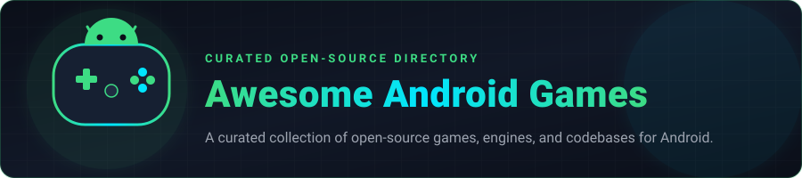

  

  
  <!-- TOTAL_GAMES_COUNT --><!-- /TOTAL_GAMES_COUNT -->
  <!-- LAST_UPDATED --><!-- /LAST_UPDATED -->
  

  A curated directory of awesome open-source Android games, game engines, and codebases.

---

## Games List

<!-- GAMES_LIST_START -->
### Categories

- [Strategy & 4X](#strategy--4x) (14)
- [Roguelike & Dungeon Crawler](#roguelike--dungeon-crawler) (13)
- [RPG & Adventure](#rpg--adventure) (10)
- [Sandbox & Simulation](#sandbox--simulation) (9)
- [Board & Card Games](#board--card-games) (50)
- [Puzzle & Logic](#puzzle--logic) (77)
- [Word, Trivia & Educational](#word-trivia--educational) (18)
- [Action & Arcade](#action--arcade) (20)
- [Platformer & Runner](#platformer--runner) (15)
- [Racing & Sports](#racing--sports) (5)
- [Rhythm & Music](#rhythm--music) (5)
- [Casual & Party](#casual--party) (62)

---

### Strategy & 4X

- **[Mindustry](https://github.com/Anuken/Mindustry)** : A sandbox tower-defense factory automation game with endless resource management.
  - ⭐ **29.7k** · Last updated: `2026-11-04` · `Java / LibGDX` · `GPL-3.0`
- **[Unciv](https://github.com/yairm210/Unciv)** : Open-source 4X civilization-building strategy game, inspired by Civ V.
  - ⭐ **11.5k** · Last updated: `2026-11-08` · `Kotlin / LibGDX` · `MPL-2.0`
- **[The Battle for Wesnoth](https://github.com/wesnoth/wesnoth)** : An open source, turn-based strategy game with a high fantasy theme.
  - ⭐ **7.0k** · Last updated: `2026-11-08` · `C++` · `GPL-2.0`
- **[VCMI](https://github.com/vcmi/vcmi)** : Open-source engine for Heroes of Might and Magic III.
  - ⭐ **6.0k** · Last updated: `2026-11-08` · `C++` · `GPL-2.0`
- **[Freeciv](https://github.com/freeciv/freeciv)** : Turn-based empire-building strategy game inspired by the history of human civilization.
  - ⭐ **1.6k** · Last updated: `2026-11-08` · `C` · `GPL-2.0`
- **[Anuto TD](https://github.com/mjaun/android-anuto)** : A minimalist, tactical tower defense game for Android with clean vector aesthetics.
  - ⭐ **241** · Last updated: `2024-09-29` · `Kotlin / Java` · `GPL-2.0`
- **[CPU Defense](https://github.com/ochadenas/cpudefense)** : A tactical tower defense game for Android based on a microprocessor architecture theme.
  - ⭐ **209** · Last updated: `2026-11-07` · `Kotlin` · `MIT`
- **[JSettlers](https://github.com/paulwedeck/settlers-remake)** *(Archived)* : A Remake of "The Settlers III" for Windows, Linux and Android.
  - ⭐ **145** · Last updated: `2025-12-02` · `Java` · `MIT`
- **[FeudalTactics](https://github.com/Sesu8642/FeudalTactics)** : Turn-based tactical strategy game with procedurally generated challenges.
  - ⭐ **122** · Last updated: `2026-10-19` · `Java` · `GPL-3.0`
- **[Turns of War](https://github.com/msx80/turnsofwar)** : A turn based strategy game.
  - ⭐ **30** · Last updated: `2026-08-31` · `Java` · `GPL-3.0`
- **[Andropolis](https://github.com/ds17f/andropolis)** : Native Android port of Micropolis (MicropolisCore C++ engine via NDK/JNI)
  - ⭐ **15** · Last updated: `2026-09-30` · `Kotlin` · `GPL-3.0`
- **[Space Trader Classic](https://github.com/lunchwine/space-trader-classic)** : An HTML/JS/CSS port of the classic Space Trader game, available as PWA or Android APK.
  - ⭐ **7** · Last updated: `2026-10-16` · `HTML` · `GPL-3.0`
- **[Latin Defense](https://github.com/bommbomm34/latindefense)** : Expand your own Roman empire!.
  - ⭐ **7** · Last updated: `2026-03-11` · `Godot` · `MIT`
- **[Dima Defense ⚔️](https://codeberg.org/xolatgames/Dima-Defense)** : A simple Tower Defense game that was made in LibGDX
  - ⭐ **6** · Last updated: `2026-10-06` · `Strategy Game` · `Apache-2.0`

### Roguelike & Dungeon Crawler

- **[Shattered Pixel Dungeon](https://github.com/00-Evan/shattered-pixel-dungeon)** : Traditional roguelike dungeon crawler RPG with deep tactical turn-based combat.
  - ⭐ **6.8k** · Last updated: `2026-10-07` · `Java / LibGDX` · `GPL-3.0`
- **[Pixel Dungeon](https://github.com/watabou/pixel-dungeon)** : The original legendary pixel-art roguelike RPG for Android.
  - ⭐ **4.0k** · Last updated: `2019-07-23` · `Java` · `GPL-3.0`
- **[Dungeon Crawl Stone Soup](https://github.com/crawl/crawl)** : Dungeon Crawl: Stone Soup official repository.
  - ⭐ **3.1k** · Last updated: `2026-11-10` · `C++` · `GPL-2.0`
- **[HyperRogue](https://github.com/zenorogue/hyperrogue)** : A SDL roguelike in a non-euclidean world.
  - ⭐ **724** · Last updated: `2026-11-07` · `C++` · `GPL-2.0`
- **[Remixed Dungeon](https://github.com/NYRDS/remixed-dungeon)** : Traditional roguelike game with enhanced classes, lore, and mods based on Pixel Dungeon.
  - ⭐ **296** · Last updated: `2026-11-08` · `Java` · `GPL-3.0`
- **[astro-loop](https://github.com/PubDeer/astro-loop)** : Clean open-source roguelike space shooter without ads or tracking.
  - ⭐ **154** · Last updated: `2026-10-23` · `Kotlin` · `GPL-3.0`
- **[Magic Ling Pixel Dungeon](https://github.com/LingASDJ/Magic_Ling_Pixel_Dungeon)** : Feature-packed magic-themed roguelike RPG branch of Shattered Pixel Dungeon.
  - ⭐ **96** · Last updated: `2026-11-08` · `Java / LibGDX` · `GPL-3.0`
- **[Cataclysm: Dark Days Ahead](https://github.com/a1studmuffin/Cataclysm-DDA-Android)** : Turn-based post-apocalyptic survival roguelike ported to Android with touch controls.
  - ⭐ **62** · Last updated: `2018-10-15` · `C++` · `CC-BY-SA-3.0`
- **[Rat King Pixel Dungeon 2](https://github.com/Zrp200/rkpd2)** : Popular Shattered Pixel Dungeon fork with enhanced hero abilities and chaotic mechanics.
  - ⭐ **45** · Last updated: `2025-06-01` · `Java / LibGDX` · `GPL-3.0`
- **[Dungeon Crawl: Stone Soup for Android](https://github.com/michaelbarlow7/dungeon-crawl-android)** : Dungeon Crawl: Stone Soup for Android (console version).
  - ⭐ **43** · Last updated: `2023-10-11` · `Java` · `GPL-2.0`
- **[Brogue CE Android](https://github.com/tyrannotorus/c-brogue-ce-android)** : Brogue: Community Edition - a modern android port of the much-loved minimalist roguelike game.
  - ⭐ **21** · Last updated: `2026-08-12` · `C / SDL` · `AGPL-3.0`
- **[VitalSlayer](https://github.com/P8-QS/VitalSlayer)** : Health-driven mobile dungeon crawler using Health Connect on Android.
  - ⭐ **12** · Last updated: `2025-05-27` · `C# / Unity` · `MIT`
- **[Pixel Spacebase](https://github.com/codefitz/Pixel-Spacebase)** : Space-themed sci-fi roguelike RPG based on Shattered Pixel Dungeon.
  - ⭐ **11** · Last updated: `2026-11-05` · `Java / LibGDX` · `GPL-3.0`

### RPG & Adventure

- **[FLARE](https://github.com/flareteam/flare-engine)** : Free/Libre Action Roleplaying Engine (engine only).
  - ⭐ **1.3k** · Last updated: `2026-10-29` · `C++` · `GPL-3.0`
- **[EasyRPG Player](https://github.com/EasyRPG/Player)** : RPG Maker 2000/2003 and EasyRPG games interpreter.
  - ⭐ **1.3k** · Last updated: `2026-11-07` · `C++` · `GPL-3.0`
- **[Stendhal Game](https://github.com/arianne/stendhal)** : Stendhal is a fun friendly and free multiplayer online adventure game with an old school feel.
  - ⭐ **707** · Last updated: `2026-07-12` · `Java` · `GPL-2.0`
- **[Idle Fantasy](https://github.com/tristinbaker/IdleFantasy)** : Fantasy Inspired Idle Skilling Game.
  - ⭐ **537** · Last updated: `2026-11-04` · `Kotlin` · `GPL-3.0`
- **[Destination Sol](https://github.com/MovingBlocks/DestinationSol)** : Open-source 2D space action RPG shooter exploring endless procedural solar systems.
  - ⭐ **351** · Last updated: `2026-10-08` · `Java / LibGDX` · `Apache-2.0`
- **[Andor's Trail](https://github.com/AndorsTrailRelease/andors-trail)** : A massive, quest-driven, turn-based fantasy RPG set in an open medieval world.
  - ⭐ **151** · Last updated: `2026-10-25` · `Java` · `GPL-2.0`
- **[DOOM & Wolfenstein RPG](https://github.com/sandstranger/doom-wolf-rpg-android-port)** : Doom, Wolfenstein RPG series, Doom64 EX+, PsyDoom, UZDoom, Perfect Dark, Arx Libertatis, FTEQW (quake 1, quake2, quake 3, hexen 2),.
  - ⭐ **108** · Last updated: `2026-11-08` · `Kotlin` · `GPL-3.0`
- **[DoggyMan3D](https://github.com/0xMartin/DoggyMan3D)** : 3D action RPG adventure game created in Unity for Android.
  - ⭐ **28** · Last updated: `2026-02-16` · `C# / Unity` · `MIT`
- **[Metal Max Remake](https://github.com/MetalMaxRemake/metalmax)** : Remake of the classic Metal Max post-apocalyptic tank RPG on Android using OpenGL ES.
  - ⭐ **20** · Last updated: `2026-10-22` · `C++ / OpenGL` · `MIT`
- **[Cavern Cravers](https://github.com/mlm-games/cavern-cravers)** : A roguelike turn-based virtual board game
  - ⭐ **2** · Last updated: `2026-07-20` · `GDScript` · `GPL-3.0`

### Sandbox & Simulation

- **[Luanti (formerly Minetest)](https://github.com/luanti-org/luanti)** : Infinite-world voxel sandbox game engine featuring modding and multiplayer support on Android.
  - ⭐ **13.8k** · Last updated: `2026-11-07` · `C++ / Lua` · `LGPL-2.1`
- **[OpenTTD](https://github.com/OpenTTD/OpenTTD)** : Open-source transport simulation game based on Transport Tycoon Deluxe.
  - ⭐ **8.5k** · Last updated: `2026-11-07` · `C++` · `GPL-2.0`
- **[freeminer](https://github.com/freeminer/freeminer)** : Freeminer is an open source sandbox game inspired by Minecraft.
  - ⭐ **475** · Last updated: `2026-11-07` · `C++`
- **[Principia](https://github.com/Bithack/principia)** : Open source physics-based sandbox game with electronic circuitry, mechanics, robots, puzzles, Lua scripting and more.
  - ⭐ **433** · Last updated: `2026-11-09` · `C++` · `BSD-2-Clause`
- **[ROTA](https://github.com/HarmonyHoney/ROTA)** : Gravity-bending block puzzle platformer game built with Godot for Android and PC.
  - ⭐ **338** · Last updated: `2026-06-25` · `GDScript / Godot` · `MIT`
- **[Endless Sky](https://github.com/thewierdnut/endless-mobile)** : Space exploration, trading, and combat game.
  - ⭐ **176** · Last updated: `2026-11-02` · `C++` · `GPL-3.0`
- **[GameOfLife](https://github.com/Efimj/GameOfLife)** : Interactive Conway's Game of Life simulation built with Jetpack Compose.
  - ⭐ **93** · Last updated: `2026-09-02` · `Kotlin / Jetpack Compose` · `MIT`
- **[GLXY](https://github.com/KaeruCT/GLXY)** : A simplified gravity simulator for Android.
  - ⭐ **24** · Last updated: `2021-06-30` · `Java` · `Apache-2.0`
- **[Plutonic](https://github.com/mlm-games/plutonic)** : A gravity-field based suikalike where you try to reach the last planet.
  - ⭐ **18** · Last updated: `2026-09-19` · `Godot` · `GPL-3.0`

### Board & Card Games

- **[Lichess](https://github.com/lichess-org/mobile)** : Lichess mobile app.
  - ⭐ **2.7k** · Last updated: `2026-11-08` · `Flutter / Dart` · `GPL-3.0`
- **[PySolFC](https://github.com/shlomif/PySolFC)** : A comprehensive, feature-rich, open source, and portable, collection of Solitaire games.
  - ⭐ **570** · Last updated: `2026-11-05` · `Python / Kivy` · `GPL-3.0`
- **[Chess](https://github.com/jcarolus/android-chess)** : Chess game for Android.
  - ⭐ **530** · Last updated: `2026-11-08` · `Java` · `MIT`
- **[DroidFish Chess](https://github.com/peterosterlund2/droidfish)** : Feature-rich open-source chess app for Android, powered by the Stockfish engine.
  - ⭐ **443** · Last updated: `2024-06-04` · `Java / C++` · `GPL-3.0`
- **[Gobandroid](https://github.com/ligi/gobandroid)** : A Goban for Android.
  - ⭐ **253** · Last updated: `2023-03-09` · `Kotlin` · `GPL-3.0-only`
- **[Mill](https://github.com/calcitem/Sanmill)** : Sanmill is an open-source, UCI-like Mill/Morris/Merrills/Mühle/Malom (and its variants) program with CUI and Flutter GUI, sharing and.
  - ⭐ **205** · Last updated: `2026-10-23` · `Flutter / Dart` · `AGPL-3.0`
- **[Blokish](https://github.com/scoutant/blokish)** : Android game. Open-source implementation of the popular board game Blokus.
  - ⭐ **112** · Last updated: `2024-10-18` · `Java` · `GPL-3.0`
- **[Dooz](https://github.com/yamin8000/Dooz)** : Dooz or Tic-tac-toe is a simple pen-and-paper game. I created this implementation using Kotlin and Jetpack Compose for Android devices.
  - ⭐ **108** · Last updated: `2026-11-06` · `Kotlin` · `GPL-3.0`
- **[tripeaks-gdx](https://github.com/mimoguz/tripeaks-gdx)** *(Archived)* : Clean TriPeaks solitaire card game built with LibGDX for Android.
  - ⭐ **90** · Last updated: `2025-03-15` · `Kotlin / LibGDX` · `GPL-3.0`
- **[Freebloks](https://github.com/shlusiak/Freebloks-Android)** : Android port of Freebloks 3D, a clone of the popular board game Blokus.
  - ⭐ **89** · Last updated: `2026-10-30` · `Kotlin` · `GPL-2.0`
- **[PlayHex](https://github.com/playhex/playhex)** : ⬣ Hex online board game ⬣.
  - ⭐ **74** · Last updated: `2026-11-06` · `TypeScript / Web` · `AGPL-3.0`
- **[Ludo (Privacy Friendly)](https://github.com/SecUSo/privacy-friendly-ludo)** : Boardgame for one to six players.
  - ⭐ **64** · Last updated: `2026-05-29` · `Java` · `GPL-3.0`
- **[TacticMaster](https://github.com/jazzm0/tactic-master)** : TacticMaster - improve chess tactical skills.
  - ⭐ **54** · Last updated: `2026-10-28` · `Java` · `GPL-3.0`
- **[Open Chaos Chess](https://github.com/CorruptedArk/open-chaos-chess)** : Open Chaos Chess is a free and open source version of Chaos Chess, stripped of Google Play Services.
  - ⭐ **51** · Last updated: `2023-07-13` · `Java` · `GPL-3.0`
- **[Halma](https://github.com/Crazy-Marvin/Halma)** : Halma Game Built With The Awesome libGDX framework.
  - ⭐ **50** · Last updated: `2026-11-01` · `Java` · `Apache-2.0`
- **[Pirate Solitaire](https://github.com/Pheonyxior/Pirate-Solitaire-Git-Repo)** : The Godot project for this game : https://victor-pernet.itch.io/pirate-solitaire accessible under the MIT License.
  - ⭐ **47** · Last updated: `2024-04-12` · `Godot` · `MIT`
- **[Cards With Cats](https://github.com/dozingcat/CardsWithCats)** : Hearts and Spades card games.
  - ⭐ **39** · Last updated: `2026-11-05` · `Flutter / Dart` · `GPL-3.0`
- **[OpenFool](https://github.com/hyst329/OpenFool)** : Open source implementation of a Fool (Durak) card game.
  - ⭐ **39** · Last updated: `2020-01-19` · `Kotlin` · `MIT`
- **[Simple Solitaire Collection](https://github.com/TobiasBielefeld/Simple-Solitaire)** *(Archived)* : \[Android\] Simple Solitaire game collection.
  - ⭐ **35** · Last updated: `2024-02-17` · `Java` · `GPL-3.0`
- **[Checkers (Privacy Friendly)](https://github.com/SecUSo/privacy-friendly-dame)** : Privacy Friendly App to play the boardgame checkers.
  - ⭐ **33** · Last updated: `2026-05-29` · `Java` · `GPL-3.0`
- **[Solitaire (Privacy Friendly)](https://github.com/SecUSo/privacy-friendly-solitaire)** : Privacy Friendly App to play Solitaire.
  - ⭐ **31** · Last updated: `2025-06-06` · `Java` · `GPL-3.0`
- **[Mobile Maia](https://github.com/Dash1971/maia-chess-android)** : An open-source, offline-first Android chess app for playing against Maia-3, with post-game Maia and Stockfish analysis and PGN export.
  - ⭐ **30** · Last updated: `2026-10-30` · `Dart` · `AGPL-3.0`
- **[Blichess](https://github.com/vovagorodok/blichess)** : Fork of lichess.org mobile application with Bluetooth e-boards support.
  - ⭐ **30** · Last updated: `2026-05-29` · `TypeScript / Web` · `GPL-3.0`
- **[Mahjong Solitaire](https://github.com/sidhant947/Mahjong)** : Classic tile-matching puzzles without interruptions, tracking, or ads.
  - ⭐ **28** · Last updated: `2026-10-01` · `Flutter / Dart` · `GPL-3.0`
- **[Tarock Palčka](https://github.com/mytja/Tarok)** : A fully open-source Tarock program for playing online (through WebSocket-based backend) or offline (using bots). Integrates StockŠkis custom-made tarock engine.
  - ⭐ **25** · Last updated: `2025-01-28` · `Flutter / Dart` · `AGPL-3.0`
- **[Battleship Game (Privacy Friendly)](https://github.com/SecUSo/privacy-friendly-battleship)** : Privacy Friendly App for playing Battleship.
  - ⭐ **23** · Last updated: `2026-10-16` · `Kotlin` · `GPL-3.0`
- **[UnoCard](https://github.com/shiawasenahikari/UnoCard)** : Open-source UNO card game for Android and PC with AI opponents.
  - ⭐ **23** · Last updated: `2025-06-09` · `Java` · `Apache-2.0`
- **[TicTacToe](https://github.com/princesanjivy/tic-tac-toe)** : Tic Tac Toe game with online multiplayer using Firebase Real-time Database & Flutter.
  - ⭐ **18** · Last updated: `2025-09-14` · `Flutter / Dart` · `MIT`
- **[Naija Ludo](https://github.com/mshdabiola/Naijaludo)** : Modern mobile edition of classic Ludo with smooth animations and multiplayer support.
  - ⭐ **15** · Last updated: `2025-10-27` · `Kotlin` · `GPL-3.0`
- **[RTTT](https://github.com/kirkezz/rttt)** : Recursive Tic-Tac-Toe game.
  - ⭐ **15** · Last updated: `2025-03-01` · `C / SDL` · `GPL-3.0`
- **[CBG -- Clavierhaus BackGammon](https://github.com/clavierhaus/gnubg-android)** : Port of the original GNU Backgammon software for a modern Android system.
  - ⭐ **14** · Last updated: `2026-10-26` · `C / SDL` · `GPL-3.0`
- **[Ultimate Tic Tac Toe](https://github.com/henrykvdb/UltimateTTTAndroid)** : Ultimate 9x9 strategic nested grid Tic-Tac-Toe for Android.
  - ⭐ **14** · Last updated: `2025-11-30` · `Kotlin` · `MIT`
- **[Square Chess](https://github.com/chriotte/square-chess)** : Free, offline-first Android chess app designed for square-screen phones and physical keyboards.
  - ⭐ **13** · Last updated: `2026-11-05` · `C++` · `GPL-3.0`
- **[Ludo](https://github.com/sidhant947/Ludo)** : A clean, ad-free, 100% offline implementation of the classic Indian cross-and-circle board game
  - ⭐ **11** · Last updated: `2026-10-27` · `Dart` · `GPL-3.0`
- **[MoveAPiece: Offline Chess](https://github.com/egdels/moveapiece)** : Offline chess app for Android and desktop - Stockfish, Maia, DGT Pegasus & Chessnut Air support. No account, no ads, GPLv3.
  - ⭐ **9** · Last updated: `2026-10-26` · `Java` · `GPL-3.0`
- **[Fairy Mahjong](https://github.com/FairyTrick/FairyMahjong)** : Clear a layered garden board with a four-slot matching hand
  - ⭐ **9** · Last updated: `2026-09-20` · `Kotlin` · `Apache-2.0`
- **[Mahjong Solitaire](https://github.com/PcmciaKai/mahjong_solitaire)** : A performance-oriented classic Mahjong Solitaire game for Android.
  - ⭐ **8** · Last updated: `2026-10-14` · `Kotlin` · `GPL-3.0`
- **[JustChess](https://gitlab.com/alaskalinuxuser/app_JustChess)** : Chess for one or two players
  - ⭐ **8** · Last updated: `2026-06-13` · `Board Game` · `Apache-2.0`
- **[Chess Puzzles](https://github.com/cocodedk/chess-puzzles)** : Android chess puzzle game — solve real Lichess tactics offline. Kotlin + Jetpack Compose, 100% tested.
  - ⭐ **7** · Last updated: `2026-11-09` · `Kotlin` · `Apache-2.0`
- **[500 - Multiplayer card game](https://github.com/rotundtapir/500)** : FOSS 500 card game app for Android
  - ⭐ **6** · Last updated: `2026-09-25` · `Kotlin` · `GPL-3.0`
- **[Flang](https://codeberg.org/jannis/FlangAndroid)** : A board game similar to chess
  - ⭐ **6** · Last updated: `2026-06-17` · `Board Game` · `GPL-3.0-or-later`
- **[OPMT](https://github.com/20Nick/OPMT)** : An android board game that is similar to Mū tōrere.
  - ⭐ **6** · Last updated: `2021-08-10` · `Java` · `GPL-3.0`
- **[Battleship](https://github.com/cocodedk/Battleship)** : Local Battleship game for Android — naval command aesthetic, clean architecture, AI opponent
  - ⭐ **4** · Last updated: `2026-10-07` · `Kotlin` · `Apache-2.0`
- **[Open Patience](https://github.com/d-rk/open-patience)** : Solitaire — free & open source, no ads, no tracking.
  - ⭐ **4** · Last updated: `2026-10-06` · `Dart` · `AGPL-3.0`
- **[Navy Fleet Battle](https://github.com/tigrino/navy-fleet-battle)** : Battleship game.
  - ⭐ **4** · Last updated: `2026-07-30` · `Kotlin` · `MIT`
- **[ConnectFour Studio](https://github.com/Patrick-Ric/connectfour-studio-android)** : ConnectFour Studio for Android: Connect Four with a perfect engine, analysis and opening book. No ads, no tracking.
  - ⭐ **3** · Last updated: `2026-10-12` · `Kotlin` · `AGPL-3.0`
- **[清正学園将棋部](https://github.com/hiroshiyui/SeiShinGakuen_ShougiBu)** : 【清正学園将棋部】シングルプレイヤー向けの Android 用本将棋ゲーム。タップ操作で 9×9 将棋盤を動かし、合法手判定（王手・二歩・打ち歩詰め・千日手）を完全に行い、AlphaZero スタイルの AI 対局相手は端末内（オフライン）で動作する。
  - ⭐ **2** · Last updated: `2026-11-09` · `GDScript` · `GPL-3.0`
- **[Collective Club Maze](https://gitlab.com/andsild/collective-club-maze)** : A game similar to the board game ricochet robots.
  - ⭐ **2** · Last updated: `2026-06-03` · `Board Game` · `GPL-3.0-or-later`
- **[Free Klondike](https://github.com/VelbazhdSoftwareLLC/Free-Klondike)** : Free Klondike is programmed in Java. This game is a mixture between FreeCell and Klondike Solitaire. Development by Matt Stephen and Todor Balabanov.
  - ⭐ **2** · Last updated: `2026-05-10` · `Java` · `GPL-3.0`
- **[Boxcars](https://codeberg.org/tslocum/boxcars-android)** : Play backgammon online via bgammon.org
  - ⭐ **1** · Last updated: `2026-11-07` · `Board Game` · `AGPL-3.0-or-later`

### Puzzle & Logic

- **[Antimine](https://github.com/lucasnlm/antimine-android)** : Clean, modern, open-source minesweeper puzzle game with customizable boards.
  - ⭐ **809** · Last updated: `2025-08-02` · `Kotlin` · `GPL-3.0`
- **[Simon Tatham's Puzzles](https://github.com/chrisboyle/sgtpuzzles)** : Android port of Simon Tatham's Puzzles.
  - ⭐ **748** · Last updated: `2025-10-21` · `C / SDL` · `MIT`
- **[LibreSudoku](https://github.com/kaajjo/LibreSudoku)** : LibreSudoku - Sudoku app for android built with Kotlin + Jetpack Compose + Material3.
  - ⭐ **745** · Last updated: `2026-10-23` · `Kotlin` · `GPL-3.0`
- **[Tetris Android](https://github.com/sandwwraith/tetris)** : Classic block puzzle game built with Kotlin and custom Android Views.
  - ⭐ **480** · Last updated: `2024-03-12` · `Kotlin` · `Apache-2.0`
- **[2048 Open Fun Game](https://github.com/andstatus/game2048)** : 2048 Open Fun Game - multiplatform implementation in Kotlin and KorGE game engine.
  - ⭐ **362** · Last updated: `2026-07-19` · `Kotlin` · `Apache-2.0`
- **[AAAAXY](https://github.com/divVerent/aaaaxy)** : A nonlinear 2D puzzle platformer taking place in impossible spaces.
  - ⭐ **305** · Last updated: `2026-11-08` · `Go / Ebitengine` · `Apache-2.0`
- **[Puzzle Suite](https://github.com/sidhant947/Puzzle)** : A suite of 270+ minimalist puzzle games built with Flutter for Android.
  - ⭐ **277** · Last updated: `2026-11-08` · `Dart / Flutter` · `GPL-3.0`
- **[Klooni1010](https://github.com/LonamiWebs/Klooni1010)** *(Archived)* : Open-source 1010 block puzzle game built with LibGDX for Android.
  - ⭐ **243** · Last updated: `2026-02-11` · `Java / LibGDX` · `GPL-3.0`
- **[tiny_crate](https://github.com/HarmonyHoney/tiny_crate)** : Crate-chucking puzzle platformer game made with Godot Engine for Android.
  - ⭐ **241** · Last updated: `2026-06-25` · `GDScript / Godot` · `Unlicense`
- **[gauguin](https://github.com/meikpiep/gauguin)** : Sudoku-like number puzzle game for Android based on arithmetic logic.
  - ⭐ **214** · Last updated: `2026-11-08` · `Kotlin` · `GPL-3.0`
- **[Sudoku (Privacy Friendly)](https://github.com/SecUSo/privacy-friendly-sudoku)** : Privacy Friendly App to play Sudoku on Android.
  - ⭐ **208** · Last updated: `2026-05-29` · `Java` · `GPL-3.0`
- **[Form-N-Fun](https://github.com/Rohithkvsp/Form-N-Fun)** : Draw a custom maze on paper and play it on your device using the accelerometer.
  - ⭐ **175** · Last updated: `2019-06-22` · `Java` · `MIT`
- **[Chogan](https://github.com/choganhq/chogan)** : Fifty short, finishable games in one free, offline, open-source app: board, card, puzzle and arcade. No ads, no trackers.
  - ⭐ **137** · Last updated: `2026-11-10` · `HTML` · `MIT`
- **[Arrow Escape: Infinite Puzzle](https://github.com/sidhant947/ArrowEscape)** : Unwind and challenge your brain with Arrow Escape, a clean, minimalist puzzle game built purely for the love of play.
  - ⭐ **112** · Last updated: `2026-11-08` · `Flutter / Dart` · `GPL-3.0`
- **[Flowit — Block Puzzle](https://github.com/Flowit-Game/Flowit)** : Minimalistic puzzle game.
  - ⭐ **104** · Last updated: `2026-10-09` · `Java` · `GPL-3.0`
- **[Minesweeper Compose](https://github.com/jayasuryat/minesweeper-j-compose)** : Modern, smooth open-source Minesweeper puzzle game built natively with Jetpack Compose.
  - ⭐ **104** · Last updated: `2024-07-12` · `Kotlin / Jetpack Compose` · `Apache-2.0`
- **[SUD💜KU](https://github.com/TheSunCat/Sudoku)** : FOSS Sudoku, made with 💜 (and Flutter). Mirror of main repository https://git.allpurposem.at/mat/Sudoku.
  - ⭐ **98** · Last updated: `2025-08-24` · `Flutter / Dart` · `GPL-3.0`
- **[Water Sort](https://github.com/sidhant947/water-sort)** : Sort the colored water in the tubes until each tube contains only one color. A relaxing and addictive color-sorting puzzle game built with Flutter.
  - ⭐ **93** · Last updated: `2026-11-07` · `Flutter / Dart` · `GPL-3.0`
- **[BlockDrop](https://github.com/brandonp2412/BlockDrop)** : A modern Tetris clone built with Flutter 🎮.
  - ⭐ **87** · Last updated: `2026-11-07` · `Flutter / Dart` · `MIT`
- **[Tessel – A tile game](https://github.com/gvtulder/tessel)** : A colorful open source tile game. Place tiles with matching colors to make shapes and fill the board. Play online or install the app!.
  - ⭐ **85** · Last updated: `2026-11-02` · `TypeScript / Web` · `GPL-3.0`
- **[Everest](https://github.com/mwageringel/everest)** : A mathematical puzzle game.
  - ⭐ **83** · Last updated: `2026-01-24` · `Flutter / Dart` · `GPL-3.0`
- **[2048 (Privacy Friendly)](https://github.com/SecUSo/privacy-friendly-2048)** : (SECUSO) Try to reach 2048 in this puzzle game.
  - ⭐ **61** · Last updated: `2026-07-20` · `Java` · `GPL-3.0`
- **[Nonocross](https://github.com/jaredforrest/nonocross)** : A simple nonogram puzzle app for Android.
  - ⭐ **49** · Last updated: `2023-07-31` · `C / SDL` · `GPL-3.0`
- **[Quiet Grid](https://github.com/lendl/quiet-grid)** : Privacy-first logic puzzle app for Android. No ads, no account, fully offline.
  - ⭐ **47** · Last updated: `2026-11-07` · `Kotlin` · `GPL-3.0`
- **[Open Sudoku](https://gitlab.com/opensudoku/opensudoku)** : Open Sudoku is an Open Source Sudoku game.
  - ⭐ **47** · Last updated: `2026-11-06` · `Puzzle Game` · `GPL-3.0-or-later`
- **[Block Puzzle Stone Wars](https://github.com/SoltauFintel/blockpuzzle)** : Block Puzzle (Android game).
  - ⭐ **47** · Last updated: `2023-01-30` · `Java` · `MIT`
- **[15 Puzzle](https://github.com/italankin/15Puzzle)** : Classic sliding 15-number tile puzzle game with customizable themes and animations.
  - ⭐ **42** · Last updated: `2026-09-29` · `Java` · `MIT`
- **[Match 3](https://github.com/sidhant947/Match3)** : Minimal and open-source Match-3 puzzle game built using Flutter.
  - ⭐ **41** · Last updated: `2026-11-07` · `Flutter / Dart` · `GPL-3.0`
- **[Box Smasher](https://github.com/rollerozxa/boxsmasher)** : A fun physics-based puzzle game where you throw balls at boxes to smash them out of the screen.
  - ⭐ **38** · Last updated: `2025-08-18` · `Lua` · `GPL-3.0`
- **[Queens](https://github.com/sidhant947/queens)** : It is a challenging crown-placement logic puzzle game where you place queens on a grid of colored regions built using Flutter.
  - ⭐ **33** · Last updated: `2026-10-31` · `Flutter / Dart` · `GPL-3.0`
- **[Minesweeper (Privacy Friendly)](https://github.com/SecUSo/privacy-friendly-minesweeper)** : (SECUSO) Privacy friendly Minesweeper without ads or permissions.
  - ⭐ **33** · Last updated: `2026-05-29` · `Java` · `GPL-3.0`
- **[SudoQ](https://github.com/timo-a/SudoQ)** : An android app for sudoku.
  - ⭐ **32** · Last updated: `2026-11-08` · `Kotlin` · `GPL-3.0`
- **[2050](https://github.com/mattvchandler/2050)** : 2048, but round!.
  - ⭐ **32** · Last updated: `2023-08-22` · `C++` · `MIT`
- **[Nonogram](https://github.com/sidhant947/Nonogram)** : Reveal hidden pixel art pictures by solving logic puzzles based on row and column number clues!.
  - ⭐ **31** · Last updated: `2026-10-23` · `Flutter / Dart` · `GPL-3.0`
- **[Tangler](https://github.com/andrzej-nov/Tangler)** : Casual knot untangling puzzle game written in Kotlin for Android and Desktop.
  - ⭐ **25** · Last updated: `2026-09-24` · `Kotlin` · `CC-BY-4.0`
- **[TerraTactician Expandoria](https://codeberg.org/terratactician_expandoria/game)** : Hexagon based logic game
  - ⭐ **24** · Last updated: `2025-12-30` · `Puzzle Game` · `AGPL-3.0-or-later`
- **[9P](https://github.com/tube42/9p)** : The Nine Puzzle.
  - ⭐ **23** · Last updated: `2023-04-23` · `Java` · `GPL-2.0`
- **[Mines3D](https://github.com/stastnypremysl/Mines3D)** : Challenging 3D layered matrix minesweeper game for Android.
  - ⭐ **21** · Last updated: `2026-09-14` · `Java` · `GPL-3.0`
- **[Block Blast](https://github.com/sidhant947/BlockBlast)** : A minimal, privacy-focused block puzzle game built with Flutter.
  - ⭐ **20** · Last updated: `2026-10-16` · `Dart` · `GPL-3.0`
- **[Sokoban(g)](https://github.com/obfusk/sokobang)** : Sokobang - sokoban puzzle w/ bigbang.coffee.
  - ⭐ **18** · Last updated: `2023-12-16` · `HTML` · `AGPL-3.0`
- **[werewolves_game](https://github.com/davidchilin/werewolves_game)** : Werewolves (mafia) webgame server (python, apk). No Narator needed, does automatic vote and death logic. Now on F-Droid!.
  - ⭐ **17** · Last updated: `2026-10-17` · `Python / Kivy` · `GPL-3.0`
- **[Screw Jam](https://github.com/sidhant947/ScrewJam)** : A clean, satisfying, and privacy-respecting screw puzzle game.
  - ⭐ **17** · Last updated: `2026-10-15` · `Dart` · `GPL-3.0`
- **[Colorgram](https://github.com/sidhant947/Colorgram)** : Solve relaxing color nonogram logic puzzles & reveal vibrant pixel art!
  - ⭐ **17** · Last updated: `2026-10-14` · `Dart` · `GPL-3.0`
- **[Shikaku](https://github.com/sidhant947/Shikaku)** : A minimalist block logic puzzle game built with Flutter
  - ⭐ **14** · Last updated: `2026-10-27` · `Dart` · `GPL-3.0`
- **[Tensy](https://github.com/rollerozxa/tensy)** : Select numbers that sum to ten
  - ⭐ **14** · Last updated: `2026-09-23` · `C` · `GPL-3.0`
- **[Hue Sort](https://github.com/sidhant947/HueSort)** : A color sorting puzzle game. Swap tiles to reconstruct the hidden gradient.
  - ⭐ **13** · Last updated: `2026-10-20` · `Dart` · `GPL-3.0`
- **[Einstein's Riddle](https://github.com/sidhant947/Einstein-Riddle)** : Also known as the Zebra Puzzle is a legendary logic grid puzzle game.
  - ⭐ **13** · Last updated: `2026-09-08` · `Flutter / Dart` · `GPL-3.0`
- **[Zoysii - Logic game](https://gitlab.com/deepdaikon/Zoysii)** : A simple logic game: find the best path to delete every number in a square space
  - ⭐ **13** · Last updated: `2026-08-24` · `Puzzle Game` · `GPL-3.0-or-later`
- **[Minesweeper](https://github.com/john-athan/minesweeper)** : Modern Minesweeper for Android — Compose + Material 3, fog of war, countdown timers. No permissions, no internet, no ads. GPL-3.0.
  - ⭐ **12** · Last updated: `2026-11-08` · `Kotlin` · `GPL-3.0`
- **[Sudoku](https://github.com/likhithpraveenk/sudoku)** : A clean sudoku app.
  - ⭐ **12** · Last updated: `2026-11-07` · `Flutter / Dart` · `GPL-3.0`
- **[Chain Relations](https://github.com/andrzej-nov/ChainRelations)** : A casual connection and chain puzzle game for Android written in Kotlin.
  - ⭐ **12** · Last updated: `2026-09-24` · `Kotlin` · `CC-BY-4.0`
- **[Free the bugs](https://github.com/mlm-games/free-the-bugs)** : A game on solving small Gava bugs
  - ⭐ **12** · Last updated: `2026-02-14` · `GDScript` · `GPL-3.0`
- **[IED](https://codeberg.org/Krixec/IED-FDroid)** : Imagine Minesweeper ... but in 3D
  - ⭐ **12** · Last updated: `2025-11-08` · `Puzzle Game` · `MIT`
- **[Matrix Puzzle](https://github.com/sidhant947/Matrix-Puzzle)** : A minimal, open-source matrix puzzle game also known as floor puzzle.
  - ⭐ **11** · Last updated: `2026-11-07` · `Dart` · `GPL-3.0`
- **[Twist Cubee](https://github.com/zk-haunt/Twist-cubee)** : Offline, open-source 3D cube puzzle for Android. 2×2 to 20×20, solver, timer. No ads, no tracking.
  - ⭐ **11** · Last updated: `2026-10-18` · `Kotlin` · `MIT`
- **[Tents](https://github.com/sidhant947/Tents)** : Place tents in the grid so that every tree is paired with a tent according to grid constraints
  - ⭐ **10** · Last updated: `2026-11-06` · `Dart` · `GPL-3.0`
- **[Cubit](https://github.com/taynotfound/cubit)** : A hard little cube of arrows. Free the pink one. Native Android puzzle, no ads, with a verified Go leaderboard.
  - ⭐ **9** · Last updated: `2026-11-05` · `Kotlin` · `MIT`
- **[Tangram](https://github.com/Typraeurion/Android-Tangram)** : Make or solve Tangram puzzles
  - ⭐ **8** · Last updated: `2026-09-21` · `Java` · `GPL-3.0`
- **[Futoshiki](https://github.com/samgrande/Simple-Futoshiki)** : A clean, modern Futoshiki puzzle game built with Kotlin.
  - ⭐ **8** · Last updated: `2026-08-07` · `Kotlin` · `Apache-2.0`
- **[Flow: Connect Dots Puzzle](https://github.com/sidhant947/Flow)** : Relax your brain with satisfying color line puzzles. Connect dots & clear boards!
  - ⭐ **7** · Last updated: `2026-10-30` · `Dart` · `GPL-3.0`
- **[Oubliettes](https://github.com/all3f0r1/oubliettes)** : Dungeon logic puzzle for Android: find the walls from the row and column counts. Campaign, endless, daily, lessons. No ads, no network.
  - ⭐ **7** · Last updated: `2026-10-21` · `Kotlin` · `GPL-3.0`
- **[Pipes: Water Flow Puzzle](https://github.com/sidhant947/Pipes)** : An addictive and relaxing logic puzzle game that challenges your brain and sharpens your spatial thinking
  - ⭐ **7** · Last updated: `2026-10-16` · `Dart` · `GPL-3.0`
- **[DropCount](https://github.com/jdanders/dropcount)** : A recreation of the classic Drop7 puzzle game for Android.
  - ⭐ **6** · Last updated: `2026-10-27` · `Kotlin` · `GPL-3.0`
- **[Hue Spill](https://github.com/sidhant947/HueSpill)** : Hue Spill! A simple, relaxing, yet incredibly challenging puzzle game.
  - ⭐ **6** · Last updated: `2026-09-09` · `Flutter / Dart` · `GPL-3.0`
- **[Regex Crossword](https://github.com/CuSO4Deposit/regex-crossword)** : Crosswords, but defined by Regex
  - ⭐ **5** · Last updated: `2026-10-28` · `Kotlin` · `MIT`
- **[Minesweeper](https://github.com/JoelDankert/Minesweeper-for-Android)** : Configurable offline Minesweeper for Android.
  - ⭐ **5** · Last updated: `2026-10-14` · `Kotlin` · `Apache-2.0`
- **[Bubble Night](https://github.com/SyscallBrain/bubble-night)** : An offline bubble shooter for Android: 600 levels in three difficulties, every variant backed by a replayable solution certificate. Kotlin + Jetpack Compose.
  - ⭐ **4** · Last updated: `2026-10-12` · `Kotlin` · `MIT`
- **[Jigsaw Solitaire](https://github.com/sidhant947/Jigsaw)** : A beautifully tactile, relaxing jigsaw puzzle game built with Flutter.
  - ⭐ **4** · Last updated: `2026-09-27` · `Dart` · `GPL-3.0`
- **[MasterMindy](https://github.com/Matteljay/mastermindy-android)** : The customizable Mastermind clone - android edition.
  - ⭐ **4** · Last updated: `2026-01-07` · `Java` · `MIT`
- **[Sudaku - Pattern-driven sudoku](https://codeberg.org/theoden8/sudaku)** : Find patterns to solve sudoku - your sudoku workhorse handles the grunt work
  - ⭐ **3** · Last updated: `2026-08-24` · `Puzzle Game` · `MIT`
- **[One Line Puzzle](https://github.com/sidhant947/OneLine)** : Draw a single continuous line to connect numbers and completely fill the grid!
  - ⭐ **2** · Last updated: `2026-10-21` · `Dart` · `GPL-3.0`
- **[Kakuro](https://github.com/sidhant947/Kakuro)** : Master your mind with Kakuro, the ultimate fusion of classic crosswords and number logic puzzles! Often called Cross Sums
  - ⭐ **2** · Last updated: `2026-09-24` · `Dart` · `GPL-3.0`
- **[Binary Puzzle](https://github.com/sidhant947/BinaryPuzzle)** : A minimalist binary placement logic puzzle game.
  - ⭐ **2** · Last updated: `2026-09-23` · `Dart` · `GPL-3.0`
- **[Block Night](https://github.com/SyscallBrain/block-night)** : An offline falling-blocks game for Android: 600 floors in 12 districts and three difficulties, every variant backed by a replayable solution certificate. Kotlin + Jetpack Compose.
  - ⭐ **1** · Last updated: `2026-10-12` · `Kotlin` · `MIT`
- **[Slitherlink: Logic Loop Puzzle](https://github.com/sidhant947/Slitherlink)** : Challenge your brain with Slitherlink, the timeless Japanese logic puzzle where deductive reasoning meets minimalist design
  - ⭐ **1** · Last updated: `2026-09-26` · `Dart` · `GPL-3.0`
- **[Triple Match](https://github.com/sidhant947/TripleMatch)** : A minimal, open-source 3D tile-matching puzzle game.
  - ⭐ **1** · Last updated: `2026-09-08` · `Dart` · `GPL-3.0`
- **[BlocksTV](https://github.com/22pumba22/BlocksTV)** : A neon-style falling-block puzzle game for Android TV, with remote, D-pad, and gamepad support.
  - ⭐ **0** · Last updated: `2026-11-08` · `Kotlin` · `MIT`

### Word, Trivia & Educational

- **[MA Word Maker](https://github.com/vayun-mathur/Modern-Apps)** : A full mobile ecosystem of 36 apps
  - ⭐ **891** · Last updated: `2026-11-08` · `Kotlin` · `GPL-3.0`
- **[Lexica](https://github.com/lexica/lexica)** : Word Game for Android - A fork of lexic (https://code.google.com/p/lexic).
  - ⭐ **341** · Last updated: `2026-09-26` · `Java` · `GPL-3.0-only`
- **[Gurgle](https://github.com/billthefarmer/gurgle)** : Fairly simple android word game.
  - ⭐ **69** · Last updated: `2026-03-10` · `Java` · `GPL-3.0`
- **[Forkyz](https://gitlab.com/Hague/forkyz)** : Crossword puzzles application, download and play.
  - ⭐ **41** · Last updated: `2026-11-07` · `Word Game` · `GPL-3.0-only`
- **[Hangman Compose](https://github.com/RajashekarRaju/hangman-compose)** : 🎮 Kotlin Multiplatform Hangman (Android, Desktop, Web, iOS) built with Compose Multiplatform. Modular architecture with shared game engine, dynamic word catalog (DSL), responsive layouts, custom creepy-themed UI + animations, cross-platform audio, hints/timer/difficulty modes, persistent settings/history, automated CI/CD deployed to GitHub pages.
  - ⭐ **39** · Last updated: `2026-03-12` · `Kotlin` · `Apache-2.0`
- **[Sopa Word Puzzle](https://github.com/djschilling/sopa)** : Grid-based word search puzzle game with physics-based interactions for Android.
  - ⭐ **36** · Last updated: `2026-07-20` · `Java` · `Apache-2.0`
- **[GuessThatPokemon](https://github.com/NimaKhajehpour/GuessThatPokemon)** : A game where you guess pokemon names and you capture them.
  - ⭐ **35** · Last updated: `2025-04-28` · `Kotlin` · `MIT`
- **[Gridle](https://github.com/billthefarmer/gridle)** : Android word game.
  - ⭐ **26** · Last updated: `2026-09-24` · `Java` · `GPL-3.0`
- **[Code Word](https://github.com/Peace-Ray/Code-Word)** : Android code-breaking game.
  - ⭐ **18** · Last updated: `2024-12-17` · `Kotlin` · `GPL-3.0`
- **[Parlera — word guessing game](https://gitlab.com/enjoyingfoss/parlera)** : A party game where your friends describe and you guess.
  - ⭐ **17** · Last updated: `2026-06-23` · `Party Game` · `AGPL-3.0-or-later`
- **[Word Tracer](https://github.com/plhosk/wordtracer)** : A crossword-like puzzle game.
  - ⭐ **15** · Last updated: `2026-04-08` · `Python / Kivy` · `MIT`
- **[Regex Crossword](https://gitlab.com/carstenhag/regex-crossword-kotlin)** : Solve Crosswords defined by Regex rules!
  - ⭐ **13** · Last updated: `2023-11-14` · `Word Game` · `Apache-2.0`
- **[unjumble](https://github.com/wbpxre150/unjumble)** : A anagram game with picture hints.
  - ⭐ **7** · Last updated: `2025-06-26` · `Kotlin` · `MIT`
- **[Find Words: Word Search Puzzle](https://github.com/sidhant947/FindWords)** : Swipe and connect scrambled letters to reveal hidden words in every puzzle
  - ⭐ **6** · Last updated: `2026-10-08` · `Dart` · `GPL-3.0`
- **[MyKanji](https://github.com/hathibelagal-dev/MyKanji)** : Yet another Android app for learning kanji.
  - ⭐ **6** · Last updated: `2025-06-13` · `JavaScript / HTML5` · `GPL-3.0`
- **[Ahorcado](https://github.com/Webierta/ahorcandroid)** : Juego de El Ahorcado para android.
  - ⭐ **6** · Last updated: `2021-04-16` · `Flutter / Dart` · `GPL-3.0`
- **[GCompris](https://invent.kde.org/education/gcompris)** : Multi-Activity Educational game for children 2 to 10
  - ⭐ **5** · Last updated: `2026-11-07` · `C++ / Qt (QML)` · `AGPL-3.0-only`
- **[Wortmühle](https://github.com/bhuepping/wortmuehle)** : Wortmühle — tägliches deutsches Wort-Puzzle, komplett offline (Android/Capacitor).
  - ⭐ **5** · Last updated: `2026-11-07` · `Python / Kivy` · `GPL-3.0`

### Action & Arcade

- **[C-Dogs SDL](https://github.com/cxong/cdogs-sdl)** : Classic overhead run-and-gun arcade shooter with campaign and cooperative multiplayer.
  - ⭐ **1.1k** · Last updated: `2026-11-07` · `C / SDL` · `GPL-2.0`
- **[idTech4A++](https://github.com/glKarin/com.n0n3m4.diii4a)** : DOOM III/Quake 4/Prey(2006) GLES on Android/Windows/Linux, DOOM 3 BFG/The Dark Mod/RTCW/Quake 1 2.
  - ⭐ **651** · Last updated: `2026-11-06` · `C / SDL` · `GPL-3.0`
- **[Vector Pinball](https://github.com/dozingcat/Vector-Pinball)** : Retro vector-graphics arcade pinball game with responsive Box2D physics.
  - ⭐ **475** · Last updated: `2026-06-29` · `Java / C++` · `GPL-3.0`
- **[retrowars](https://github.com/retrowars/retrowars)** : Multiplayer retro game arcade engine for Android featuring cross-game battles.
  - ⭐ **239** · Last updated: `2026-10-16` · `Kotlin` · `GPL-3.0`
- **[Ricochlime](https://github.com/adil192/ricochlime)** : Fast-paced, satisfying top-down slime arena monster shooter game for Android.
  - ⭐ **166** · Last updated: `2026-11-01` · `Dart / Flutter` · `AGPL-3.0`
- **[Bim!](https://github.com/j-jorge/bim)** : Bim! is a last-man-standing arcade online game for Android.
  - ⭐ **90** · Last updated: `2026-11-06` · `C++` · `AGPL-3.0`
- **[Breakout 71](https://gitlab.com/lecarore/breakout71)** : Break colourful bricks, catch bouncing coins and select powerful upgrades !
  - ⭐ **53** · Last updated: `2026-11-03` · `Action Game` · `AGPL-3.0-only`
- **[Doors of Doom](https://github.com/msx80/DoorsOfDoomOmicron)** : Doors of Doom.
  - ⭐ **47** · Last updated: `2026-09-24` · `Java` · `Apache-2.0`
- **[Fire Strike Retro](https://github.com/restorer/fire-strike)** : An old–school 3d–shooter with cartoon graphics from creators of Gloomy Dungeons.
  - ⭐ **22** · Last updated: `2021-11-20` · `Java` · `MIT`
- **[Asteroid's Revenge](https://github.com/mlm-games/asteroids-revenge)** : An endless highscore based game.
  - ⭐ **20** · Last updated: `2025-11-24` · `Godot` · `GPL-3.0`
- **[Stack Tower 3D](https://github.com/Eve-146T/3DStackTower)** : Stack sliding blocks into the tallest tower you can. One-tap 3D arcade.
  - ⭐ **16** · Last updated: `2026-06-21` · `Java` · `GPL-3.0`
- **[Space Vertex Multiplayer](https://github.com/smart-fun/SpaceVertex)** : Android multiplayer game
  - ⭐ **15** · Last updated: `2026-10-18` · `Java` · `MIT`
- **[Brick Blast](https://github.com/ashrafimostafa/Brick-Blast)** : Modern arcade brick-breaking game built with Kotlin and Jetpack Compose.
  - ⭐ **13** · Last updated: `2026-08-28` · `Kotlin / Jetpack Compose` · `MIT`
- **[Bubble Shooter](https://github.com/sidhant947/BubbleShooter)** : 2D bubble shooter puzzle game. Match colors, clear the grid, unlock levels, or relax in Zen mode.
  - ⭐ **9** · Last updated: `2026-09-12` · `Dart` · `GPL-3.0`
- **[King Pong](https://github.com/KingAlexGilbert/king-pong)** : Retro Pong-inspired arcade campaign game for browsers, Android, Linux, and Windows, with multiplayer, progressive paddle shapes, and a secret ending.
  - ⭐ **6** · Last updated: `2026-11-03` · `HTML` · `AGPL-3.0`
- **[Dark Echo](https://github.com/kushaagrasood/dark-echo-flutter)** : 2D survival horror game with procedural mazes and intelligent AI enemy - built from scratch using Flutter's rendering APIs.
  - ⭐ **6** · Last updated: `2026-02-15` · `Dart` · `MIT`
- **[Cat a shooter 😼](https://codeberg.org/xolatgames/cat-a-shooter)** : Fly in the space by the cat 😼, and shoots off from enemies 🛸
  - ⭐ **5** · Last updated: `2026-09-19` · `Shooter Game` · `Apache-2.0`
- **[Frozen Bubble SDL3](https://github.com/dchau360/frozen-bubble-sdl3)** : Frozen Bubble 2, rewritten in C++/SDL3: online multiplayer for up to 20 players, bots, tournaments and replays. Play on Linux, macOS, Windows, Android or in your browser.
  - ⭐ **4** · Last updated: `2026-10-30` · `C++` · `GPL-2.0`
- **[Peace Break](https://github.com/tristan-reig/Peace-Break)** : A retro arcade brick breaker with online scores and unlockable skins.
  - ⭐ **2** · Last updated: `2026-09-15` · `Dart` · `GPL-3.0`
- **[Anarch RE](https://git.sr.ht/~marcin-serwin/anarch-re-android)** : Public domain from-scratch suckless Doom clone
  - ⭐ **0** · Last updated: `2026-05-04` · `C / Suckless` · `CC0-1.0`

### Platformer & Runner

- **[Flappy Bird](https://github.com/VadimBoev/FlappyBird)** : Ultra-lightweight native C open-source clone of Flappy Bird for Android.
  - ⭐ **2.4k** · Last updated: `2026-05-17` · `C / NDK`
- **[Open Surge](https://github.com/alemart/opensurge)** : 2D retro side-scrolling platformer game inspired by classic 16-bit Sonic games.
  - ⭐ **486** · Last updated: `2026-10-09` · `C / Allegro` · `GPL-3.0`
- **[TheXTech](https://github.com/Wohlstand/TheXTech)** : The full port of the SMBX engine from VB6 into C++ and SDL2, FreeImage and MixerX.
  - ⭐ **427** · Last updated: `2026-11-07` · `C++` · `GPL-3.0`
- **[tails-adventure](https://github.com/mechakotik/tails-adventure)** : Tails Adventure 2D action platformer remade from the ground up for Android and PC.
  - ⭐ **160** · Last updated: `2026-10-11` · `C++` · `GPL-3.0`
- **[TowerJumper](https://github.com/Dariasteam/TowerJumper)** : Casual ability game.
  - ⭐ **142** · Last updated: `2019-12-20` · `C++` · `GPL-3.0`
- **[FaFa Runner](https://github.com/fafarunner/fafarunner)** : Enjoy smooth gameplay, stunning graphics, and endless fun.
  - ⭐ **97** · Last updated: `2026-11-06` · `Flutter / Dart` · `MIT`
- **[Pekka Kana 2](https://github.com/danilolc/pk2)** : Pekka Kana 2, a platformer game.
  - ⭐ **95** · Last updated: `2023-05-17` · `C++` · `MIT`
- **[Cube Run](https://github.com/Eve-146T/cube-run)** : 3D endless runner but you are cube.
  - ⭐ **77** · Last updated: `2026-11-07` · `Kotlin` · `GPL-3.0`
- **[BlastOff](https://github.com/Ranger-NF/BlastOff)** : 🚀 BlastOff is a casual endless runner game featuring vector graphics. Built using Godot v4.2.2.
  - ⭐ **29** · Last updated: `2026-09-21` · `Godot` · `GPL-3.0`
- **[Run01](https://github.com/is-cout/run01-unity-game)** : 3D endless runner game with fluid obstacle traversal built in Unity.
  - ⭐ **21** · Last updated: `2025-02-21` · `C# / Unity` · `GPL-3.0`
- **[CapybaraAdventure](https://github.com/revenkogrisha/CapybaraAdventure)** : Charming casual capybara adventure runner game for Android.
  - ⭐ **21** · Last updated: `2025-02-11` · `C# / Unity` · `Apache-2.0`
- **[alexvsbus](https://github.com/M374LX/alexvsbus)** : Fast-paced platform runner game in which Alex races to catch the bus on time.
  - ⭐ **19** · Last updated: `2026-11-07` · `C / SDL` · `MIT`
- **[Egg Returns Home](https://github.com/yepgoryo/EggReturnsHome)** : Egg Returns Home is a simple platformer about an egg, which is trying to find his way back home.
  - ⭐ **15** · Last updated: `2026-10-14` · `Godot` · `CC0-1.0`
- **[Play Maker](https://codeberg.org/MysticJungle/play-maker)** : Play or create your own platformer levels
  - ⭐ **14** · Last updated: `2026-04-16` · `Platformer Game` · `CC0-1.0`
- **[jSlide2](https://codeberg.org/hasya101/jSlide2)** : A short 3D Platformer with an Online Highscore and viewable Replays.
  - ⭐ **1** · Last updated: `2026-10-19` · `Platformer Game` · `GPL-3.0-or-later`

### Racing & Sports

- **[SuperTuxKart](https://github.com/supertuxkart/stk-code)** : 3D open-source arcade kart racing game with multiplayer and vibrant tracks.
  - ⭐ **5.5k** · Last updated: `2026-11-03` · `C++` · `GPL-3.0`
- **[Open Golf](https://github.com/mgerdes/Open-Golf)** : A cross-platform minigolf game written in C.
  - ⭐ **1.9k** · Last updated: `2024-03-18` · `C / SDL` · `MIT`
- **[Pixel Wheels](https://github.com/agateau/pixelwheels)** : Top-down retro 2D racing game with multiple vehicle classes, weapons, and tracks.
  - ⭐ **460** · Last updated: `2026-04-18` · `Java / LibGDX` · `GPL-3.0`
- **[Lato](https://gitlab.com/ar-/lato)** : A downhill snowboard game with beautiful graphics
  - ⭐ **37** · Last updated: `2026-11-07` · `Sport Game` · `GPL-3.0-or-later`
- **[DragTree](https://github.com/flyboy-byte/drag-tree)** : NHRA Pro Tree drag strip reaction timer — Expo React Native app
  - ⭐ **1** · Last updated: `2026-10-22` · `TypeScript` · `MIT`

### Rhythm & Music

- **[UltraStar Play](https://github.com/UltraStar-Deluxe/Play)** : Free and open-source singing rhythm party game with companion app support.
  - ⭐ **510** · Last updated: `2026-10-21` · `C# / Unity` · `MIT`
- **[Beat Feet](https://github.com/beat-game/beat-game)** : Jump your way through cities, each automatically generated from the beat of the music.
  - ⭐ **86** · Last updated: `2026-11-02` · `Kotlin` · `GPL-3.0`
- **[PianOli](https://github.com/nicolasbrailo/PianOli)** : Android baby game.
  - ⭐ **78** · Last updated: `2026-07-03` · `Java` · `GPL-3.0`
- **[Subster](https://github.com/pLum0/subster)** : Backend-free Hitster-style music timeline party game that plays your own Subsonic/Navidrome library.
  - ⭐ **9** · Last updated: `2026-10-08` · `TypeScript / Web` · `MIT`
- **[Echo Tiles - Play Your Music](https://github.com/sidhant947/EchoTiles)** : Whether you love EDM, classical piano, pop hits, or indie beats, tap along to the music you already own—completely offline, private, and ad-free.
  - ⭐ **5** · Last updated: `2026-11-05` · `Dart` · `GPL-3.0`

### Casual & Party

- **[LiveGalGame](https://github.com/JStone2934/LiveGalGame)** : 修复了现实世界里和异性对话没有选择项的 Bug.
  - ⭐ **2.5k** · Last updated: `2026-01-31` · `JavaScript / HTML5` · `MIT`
- **[Braincup](https://github.com/SimonSchubert/Braincup)** : Open-source memory, focus, and math brain training game built with Kotlin Multiplatform.
  - ⭐ **347** · Last updated: `2026-11-07` · `Kotlin / Compose Multiplatform` · `Apache-2.0`
- **[ReGeX](https://github.com/phikal/ReGeX)** : A Regular Expression game for Android.
  - ⭐ **104** · Last updated: `2022-02-21` · `Java` · `GPL-3.0`
- **[Enchanted Fortress](https://github.com/subchannel13/EnchantedFortress)** : A simple game about managing resources of a fortress. Distribute your workforce, survive demon attacks and find a way to stop demon threat.
  - ⭐ **62** · Last updated: `2023-04-04` · `Java` · `LGPL-3.0`
- **[Apple Flinger](https://gitlab.com/ar-/apple-flinger)** : Funny single- and multiplayer game - Use a slingshot to shoot with apples
  - ⭐ **55** · Last updated: `2026-11-07` · `Shooter Game` · `GPL-3.0-or-later`
- **[Mobapp Game](https://github.com/vipaoL/mobapp-game)** : A crossplatform game based on emini physics engine.
  - ⭐ **50** · Last updated: `2026-10-31` · `Java` · `GPL-3.0`
- **[Xeonjia: Ice Adventures](https://gitlab.com/deepdaikon/Xeonjia)** : Save the world by solving ice puzzles and defeating enemies!
  - ⭐ **46** · Last updated: `2026-08-27` · `Puzzle Game` · `GPL-3.0-or-later`
- **[Planes Android](https://github.com/xxxcucus/planes)** : Variant of battleships game.
  - ⭐ **43** · Last updated: `2026-11-07` · `Kotlin` · `MIT`
- **[Mental Math](https://codeberg.org/Mental-Math/MentalMath)** : Practice mental arithmetic solo or compete with friends.
  - ⭐ **43** · Last updated: `2026-11-07` · `Educational Game` · `GPL-3.0-only`
- **[Edge Roll](https://github.com/Eve-146T/edge-roll)** : Roll roll roll roll roll roll roll roll roll roll roll roll AHHHHHHHHHH.
  - ⭐ **40** · Last updated: `2026-08-02` · `Kotlin` · `GPL-3.0`
- **[Lona](https://github.com/lufte/lona)** : A snake-like html5 game.
  - ⭐ **40** · Last updated: `2021-08-23` · `Java` · `GPL-3.0`
- **[Burger Party](https://github.com/agateau/burgerparty)** : A time management game for Android where you play a fast-food owner who must put together the burgers ordered by her customers before time runs out.
  - ⭐ **39** · Last updated: `2026-03-05` · `Java` · `Apache-2.0`
- **[Cow's Revenge](https://github.com/Dariasteam/Cows-Revenge)** : Casual platform game project for learning purposes.
  - ⭐ **39** · Last updated: `2020-09-04` · `PHP`
- **[TriPeaks NEUE](https://github.com/mimoguz/tripeaks_neue)** : A simple Tri Peaks game, take two.
  - ⭐ **38** · Last updated: `2026-11-08` · `Flutter / Dart` · `AGPL-3.0`
- **[Tux Rider](https://github.com/drodin/TuxRider)** : A port of Tux Rider (Tux racer clone) from iPhone to Android.
  - ⭐ **37** · Last updated: `2020-01-24` · `C / SDL` · `GPL-2.0-or-later`
- **[Li-Ri](https://github.com/petitlapin/Li-ri)** : Fork of https://ri-li.sourceforge.net/.
  - ⭐ **35** · Last updated: `2026-06-22` · `C++` · `GPL-3.0`
- **[Adnihilation](https://github.com/TrianguloY/Adnihilation)** : Android app by TrianguloY: Adnihilation.
  - ⭐ **34** · Last updated: `2022-03-07` · `Java`
- **[Memo Game (Privacy Friendly)](https://github.com/SecUSo/privacy-friendly-memo-game)** : Privacy Friendly App for playing "pairs" on Android devices.
  - ⭐ **33** · Last updated: `2026-07-11` · `Java` · `GPL-3.0`
- **[Falling Blocks](https://github.com/Sajeg/falling-blocks)** : A mobile Game, where you need to collect the blocks matching your colour.
  - ⭐ **33** · Last updated: `2024-09-05` · `Godot` · `MIT`
- **[CuboidalDrift](https://github.com/virejdasani/CuboidalDrift)** : Fast-paced casual 3D isometric drifting game built natively for Android.
  - ⭐ **33** · Last updated: `2023-03-20` · `Java` · `MIT`
- **[Eat Poop You Cat](https://github.com/JamesOsborn-SE/eat-poop-you-cat-android)** : Party game of telephone with drawings and words.
  - ⭐ **32** · Last updated: `2026-10-31` · `Kotlin` · `GPL-3.0`
- **[Colorful](https://github.com/suve/LD25)** : Colorful - Ludum Dare 25 (December 2012) entry.
  - ⭐ **31** · Last updated: `2026-08-18` · `Pascal` · `Zlib`
- **[🍓🍓🍓](https://github.com/Eve-146T/STRAWBERRY)** : 🍓🍓🍓.
  - ⭐ **30** · Last updated: `2024-08-10` · `Java` · `GPL-2.0`
- **[Reckoning Skills (Privacy Friendly)](https://github.com/SecUSo/privacy-friendly-reckoning-skills)** : Privacy Friendly App to train reckoning skills on Android.
  - ⭐ **29** · Last updated: `2026-10-27` · `Java` · `GPL-3.0`
- **[Eidetic](https://github.com/hathibelagal-dev/Eidetic-Memory-Trainer)** : A simple Android app that helps you improve your working memory.
  - ⭐ **29** · Last updated: `2025-04-26` · `Java` · `Apache-2.0`
- **[PipePanic](https://github.com/rnauber/pipepanic-android)** : Pipepanic for android.
  - ⭐ **29** · Last updated: `2024-05-24` · `JavaScript / HTML5` · `MIT`
- **[Freedoom](https://github.com/emileb/Freedoom-for-Android)** : Freedoom with GZDoom for Android.
  - ⭐ **28** · Last updated: `2021-02-12` · `C / SDL` · `GPL-2.0`
- **[Mafia](https://github.com/IamRezaMousavi/Mafia)** : A Mafia party game app for Android +4.4 using Clean Architecture, MVVM, Kotlin and View Binding Build with ❤️.
  - ⭐ **27** · Last updated: `2026-11-07` · `Kotlin` · `GPL-3.0`
- **[Frogue](https://github.com/necrashter/frogue)** : 3D FPS with Boss Fights and Randomized Weapons.
  - ⭐ **27** · Last updated: `2026-05-18` · `Jupyter Notebook` · `MIT`
- **[99Managers Futsal Edition](https://codeberg.org/dulvui/99managers-futsal-edition)** : A futsal management game with a 2D match engine and integrated editor.
  - ⭐ **24** · Last updated: `2026-11-06` · `Sport Game` · `AGPL-3.0-or-later`
- **[RaumBaller](https://github.com/KaeruCT/RaumBaller)** : Old-school scrolling shoot 'em up game for Android.
  - ⭐ **23** · Last updated: `2026-06-28` · `Java` · `GPL-3.0`
- **[Libre Memory Game](https://codeberg.org/quentin-bettoum/libre-memory-game)** : A memory game
  - ⭐ **22** · Last updated: `2026-09-13` · `Educational Game` · `AGPL-3.0-only`
- **[Digits](https://github.com/foxtrotdev/learn-digits)** : App dedicated to children, allowing them to learn numbers in an interactive and fun way!.
  - ⭐ **22** · Last updated: `2026-07-01` · `Kotlin` · `Apache-2.0`
- **[BobBall](https://github.com/bobthekingofegypt/BobBall)** : A jezzball style clone for android.
  - ⭐ **22** · Last updated: `2024-08-22` · `Java` · `BSD-2-Clause`
- **[I Keep Having This Dream](https://github.com/FuzionCD/dream-game-android)** : Source code for the Android game "I Keep Having This Dream".
  - ⭐ **21** · Last updated: `2026-11-04` · `C++` · `GPL-3.0`
- **[Roboyard](https://github.com/Eastcoast-Laboratories/Roboyard)** : Problem-solving Android game - find the optimal moves to move one robot to its target.
  - ⭐ **21** · Last updated: `2026-10-30` · `Java` · `GPL-3.0`
- **[Paper Loop 2](https://github.com/Eve-146T/paper-loop2)** : Grow your turf and slice other sneks' tails — a free-movement territory game.
  - ⭐ **21** · Last updated: `2026-08-02` · `Kotlin` · `GPL-3.0`
- **[RUTMath](https://github.com/przemarbor/RUTMath)** : Open source (GPL) application to help learning mathematics for early school children.
  - ⭐ **20** · Last updated: `2025-09-25` · `Kotlin` · `GPL-3.0`
- **[Dice Game (Privacy Friendly)](https://github.com/SecUSo/privacy-friendly-dice-game)** : Android Application to play game with five dice.
  - ⭐ **19** · Last updated: `2026-05-29` · `Java` · `GPL-3.0`
- **[RoboZZle Droid](https://github.com/lostmsu/RoboZZle-Droid)** : Android port of RoboZZle game.
  - ⭐ **19** · Last updated: `2023-09-16` · `Java` · `MIT`
- **[MOROway App](https://github.com/MOROway/moroway-app-oc)** : MOROway App OC ("Open Cordova").
  - ⭐ **18** · Last updated: `2026-10-11` · `Shell` · `GPL-3.0`
- **[Candy Memory](https://github.com/tube42/candymem)** : Candy Memory: a match two memory game for Android.
  - ⭐ **18** · Last updated: `2023-04-23` · `Java` · `GPL-2.0`
- **[Egyptian Mouse Pounce](https://github.com/dozingcat/MousePounce)** : Egyptian Rat Screw in Flutter.
  - ⭐ **15** · Last updated: `2026-10-05` · `Flutter / Dart` · `GPL-3.0`
- **[Quinb: 4 players reaction game](https://gitlab.com/deepdaikon/Quinb)** : A multiplayer reaction game: train your mind and your reflexes while having fun!
  - ⭐ **13** · Last updated: `2026-08-24` · `Action Game` · `GPL-3.0-or-later`
- **[Flicky Bee](https://github.com/lettucepie/flicky_bee)** : Casual Game for mobile.
  - ⭐ **12** · Last updated: `2026-03-24` · `Godot` · `GPL-3.0`
- **[FreeCell4](https://github.com/lufebe16/freecell4maemo)** : Port of freecell app from nokia n900 to android.
  - ⭐ **11** · Last updated: `2026-09-16` · `Python / Kivy` · `GPL-3.0`
- **[Dots'n'Boxes](https://github.com/StefanOltmann/Kaesekaestchen)** : Käsekästchen.
  - ⭐ **10** · Last updated: `2026-08-12` · `Kotlin` · `GPL-3.0`
- **[Mancala](https://github.com/Willie169/mancala-android)** : Mancala Game.
  - ⭐ **10** · Last updated: `2026-05-31` · `Java` · `AGPL-3.0`
- **[HyleX (Entropy / Hyle 7)](https://github.com/jenspfahl/hylex)** : A Hyle7 / Entropy clone.
  - ⭐ **9** · Last updated: `2026-07-11` · `Flutter / Dart` · `GPL-3.0`
- **[Paper Loop](https://github.com/Eve-146T/paper-loop)** : Its paper io but better and on fdroid.
  - ⭐ **9** · Last updated: `2026-07-03` · `Python / Kivy` · `GPL-3.0`
- **[Impostor MX](https://github.com/retired64/ImpostorMX)** : Juego de deducción social offline construido con Flutter.
  - ⭐ **9** · Last updated: `2026-06-07` · `Flutter / Dart` · `GPL-3.0`
- **[Kumquats](https://github.com/dozingcat/Kumquats)** : Place letters to create intersecting words as quickly as possible.
  - ⭐ **9** · Last updated: `2025-03-08` · `Flutter / Dart` · `GPL-3.0`
- **[Geoperion](https://github.com/vulnerabbity/Geoperion)** : FOSS geography games build by ionic.
  - ⭐ **9** · Last updated: `2022-07-08` · `TypeScript / Web` · `GPL-3.0`
- **[Ball2Box](https://codeberg.org/dulvui/ball2box)** : Swipe to shoot the ball in over 120 Levels. Can you collect the 3 stars?
  - ⭐ **8** · Last updated: `2025-10-23` · `Shooter Game` · `AGPL-3.0-or-later`
- **[Retro Stack](https://codeberg.org/cosmin/retro-stack-gdx)** : Build a tower with a moving set of bricks
  - ⭐ **6** · Last updated: `2026-06-05` · `Puzzle Game` · `GPL-3.0-or-later`
- **[ToberQuizz](https://github.com/Tobertet/ToberQuizz)** : Challenges that will put your imagination in check.
  - ⭐ **6** · Last updated: `2022-09-25` · `TypeScript / Web` · `GPL-3.0`
- **[Blidraughts](https://github.com/vovagorodok/blidraughts)** : Fork of lidraughts.org mobile application with Bluetooth e-boards support.
  - ⭐ **5** · Last updated: `2026-05-12` · `TypeScript / Web` · `GPL-3.0`
- **[Collect the Cookies!](https://codeberg.org/MysticJungle/collect-the-cookies)** : Collect cookies in this fun idle-ish game
  - ⭐ **5** · Last updated: `2026-04-16` · `Casual Game` · `CC0-1.0`
- **[Snakes](https://gitlab.com/mir06/snakes)** : Make your way through an extended version of Snake with computer-controlled oppo
  - ⭐ **3** · Last updated: `2026-11-04` · `Action Game` · `GPL-3.0-or-later`
- **[Pocket Broomball](https://codeberg.org/dulvui/pocket-broomball)** : The world's first Broomball video game with 100+ real world teams!
  - ⭐ **3** · Last updated: `2025-11-08` · `Sport Game` · `AGPL-3.0-or-later`
- **[1010! Klooni](https://codeberg.org/Lonami/Klooni1010)** : A libGDX game based on 1010
  - ⭐ **2** · Last updated: `2026-02-11` · `Puzzle Game` · `GPL-3.0-or-later`
- **[Tile Match](https://gitlab.com/infrared-developer/tile-match)** : Match, tap, and clear your way to victory!
  - ⭐ **1** · Last updated: `2026-10-03` · `Puzzle Game` · `GPL-3.0-or-later`
<!-- GAMES_LIST_END -->

---

## Contributing

Contributions are very welcome! If you know of an awesome open-source Android game that should be on this list:

1. Check that the project is **open-source** and has runnable/buildable code for Android.
2. Edit `games.json` or run `uv run python src/update_stats.py --add <github_repo_url> --desc "..." --tech "..."`.
3. Submit a Pull Request.

Please see [CONTRIBUTING.md](CONTRIBUTING.md) for full guidelines.

---

## License

This repository is dedicated to the public domain under the [Creative Commons Zero v1.0 Universal (CC0 1.0)](LICENSE) license.
